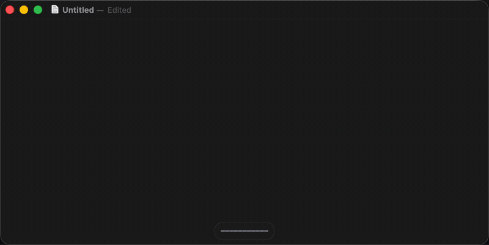

# Talk To Me Man

Free, unlimited, fully local push-to-talk dictation for Apple Silicon Macs.
Hold **Right Option**, speak, release: the text is pasted into the focused app.
No cloud, no subscription, nothing leaves your machine.



*Spoken: "Let's meet on Tuesday, no, Wednesday at three." Pasted: "Let's meet on Wednesday at 3."*

- **Transcription:** [mlx-whisper](https://github.com/ml-explore/mlx-examples) (`whisper-large-v3-turbo`), fully on-device.
- **Self-correction cleanup (optional):** a local [Ollama](https://ollama.com) model turns
  "Tuesday, no, Wednesday" into "Wednesday". It only runs when your sentence contains a correction cue.
- **Live feedback:** a frosted-glass pill with a waveform while you speak, three pulsing dots while it
  transcribes, and a check mark when the text is pasted. Start and stop sounds too.
- **Spoken punctuation edits:** after dictating, say "comma", "full stop", "question mark", "quotes"... as a
  separate dictation to fix the previous text.
- **Menu bar app:** an Option-key (⌥) icon that turns bold while recording, plus pause and Smart-cleanup toggles.

## Requirements

macOS on Apple Silicon, Python 3.10+, and (optional) Ollama with `qwen2.5:3b`.

## Install

```bash
git clone https://github.com/praneel-core/talk-to-me-man.git && cd talk-to-me-man
python3 -m venv venv
venv/bin/pip install -r requirements.txt        # or: venv/bin/pip install -r requirements.lock

# optional: smart cleanup
brew install ollama && brew services start ollama
ollama pull qwen2.5:3b
```

The first run downloads the Whisper model (~1.5 GB).

## Run

```bash
venv/bin/python -m talktomeman            # terminal, Ctrl+C to quit
venv/bin/python -m talktomeman.menubar    # menu bar app
scripts/build_app.sh                  # build ~/Applications/Dictate.app (launch from Spotlight)
```

### macOS permissions (one-time)

System Settings → Privacy & Security → add **Dictate.app** (or your terminal) **and** the venv's
`Python.app` (`<brew prefix>/Cellar/python@3.x/.../Resources/Python.app`) under **Accessibility**,
**Input Monitoring** and **Microphone**. Quit and reopen the app afterwards. Rebuilding the app
changes its signature, so you have to re-grant after `build_app.sh`.

Optional: add Dictate.app to Login Items. Ollama started via `brew services` already launches at login.

## Customise

- Settings (hotkey, models, thresholds, cleanup prompt): [talktomeman/config.py](talktomeman/config.py)
- Your own names and jargon for Whisper: one per line in `~/.config/talktomeman/words.txt`
- Log of the menu bar app: `/tmp/dictate.log`

## Layout

```
talktomeman/
  config.py     settings, prompts, vocabulary
  textproc.py   pure text logic (cleanup, punctuation commands, guards), unit-tested
  llm.py        Ollama call + safety checks
  core.py       hotkey, mic, transcription, paste
  menubar.py    rumps menu bar wrapper
scripts/        build_app.sh, make_icon.py
tests/          pytest suite for textproc
```

## Develop

```bash
venv/bin/pip install pytest && venv/bin/python -m pytest
```

## Known limits

- Punctuation commands edit the last pasted text by selecting it with Shift+Left, so they only work while
  the cursor is still right after that text (and within 2 minutes).
- Whisper large-v3-turbo takes ~1.5-2 s per short dictation; `whisper-small-mlx` is faster but less accurate.

## License

MIT
